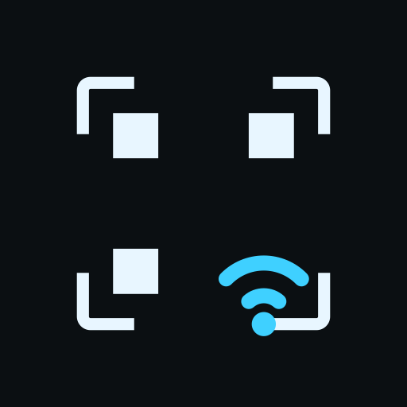

# WifiScan — join Wi-Fi by scanning a QR code with your smart glasses

**English** · [中文说明](README.zh-CN.md)

A tiny standalone app for Rokid Glasses (and any Android 12+ device with a camera):
point the glasses at the Wi-Fi sharing QR code on your phone, and the credentials are handed
to Android so the system connects to that network and **remembers it across reboots**.
No typing a password on a one-line HUD, no companion app, no root, no Google services.



## Why this exists

1. **Typing a Wi-Fi password on glasses is miserable.** A QR code is the natural input — your
   phone already displays one (Settings → WLAN → Share).
2. **Rokid's system turns Wi-Fi off on its own.** When the glasses are taken off, the firmware's
   `SpriteWifiService` disables Wi-Fi, which kills any live stream / relay connection. This app
   is the quickest way back onto a network.
3. **You want it remembered.** Handing the credentials to the system once means automatic
   re-joins later, without opening anything.

## What it does

- Live camera preview with a framing reticle; status band on top, message band at the bottom.
- Decodes the standard `WIFI:T:WPA;S:<ssid>;P:<password>;;` QR format (zxing, pure Java — no GMS).
- Hands the credentials to Android with `WifiNetworkSuggestion` (API 29+): the only root-free path
  where the **system** owns the network, auto-joins it and persists it.
- Beeps when a code is read (one beep on success, a low double tone on failure).
- If the scanned network is not the one currently connected, it opens the system Wi-Fi list so you
  can tap it once — see the platform limits below.

## Platform limits (measured on the device, not guessed)

| Symptom | Reality |
|---|---|
| The app cannot turn Wi-Fi on | Android 10+ forbids `setWifiEnabled` for ordinary apps — the call returns `false`. The app falls back to `Settings.ACTION_WIFI_SETTINGS`, which does open on this ROM. |
| The scanned network is not switched to | Android's network selection gives a large bonus to the currently connected / saved network. It will not drop a working network for a *suggested* one. Suggestions take effect when you are **not** on a usable network (just booted, Wi-Fi just re-enabled, new location). |
| Force the switch | Not exposed to third-party apps any more (`addNetwork`/`enableNetwork` are closed, `allowAutoJoin` is owner-only). One tap in the system Wi-Fi list works, and marks the network as user-approved afterwards. |
| Panel action | `android.settings.panel.action.INTERNET_CONNECTIVITY` does not exist on this ROM; `WIFI_SETTINGS` does. |

## Verified on

- Rokid Glasses, Android 12 / API 32 (YodaOS-Sprite), no GMS.
- Built against SDK 36 with JDK 21 (Android Studio's bundled JBR).
- Real runs: QR decode → suggestion accepted (`STATUS_NETWORK_SUGGESTIONS_SUCCESS`) → join.
  Camera preview, touchpad gestures and the HUD were all checked on the device via adb.

## Build

```bash
export JAVA_HOME="/Applications/Android Studio.app/Contents/jbr/Contents/Home"   # JDK 21
./gradlew assembleDebug
adb install -r app/build/outputs/apk/debug/app-debug.apk
```

Runtime permissions: `CAMERA` (scanning) and `ACCESS_FINE_LOCATION` (required by the Wi-Fi
suggestion API on older releases).

## Use (glasses touchpad)

| Gesture | Action |
|---|---|
| Single tap | Re-scan / submit again |
| Double tap | Exit |
| Long press | Exit |

Debug hook to exercise the whole pipeline without a camera:

```bash
adb shell am start -n com.takano.wifiscan/.MainActivity \
  --es fakeqr 'WIFI:T:WPA;S:MyWiFi;P:12345678;;'
adb shell logcat -s WifiScan:I
```

## Layout

```
app/src/main/java/com/takano/wifiscan/
├── MainActivity.kt   # HUD + gestures + flow (scan → suggest → fall back to the Wi-Fi list)
├── QrScanner.kt      # CameraX ImageAnalysis + zxing (tries 4 rotations)
├── WifiJoiner.kt     # WifiNetworkSuggestion submit, status reporting, stale-suggestion cleanup
├── HudView.kt        # custom-drawn HUD layered over the live preview
└── IpInfo.kt         # IPv4 via ConnectivityManager (NetworkInterface is unreadable on API 30+)
```

## Credits

- [zxing](https://github.com/zxing/zxing) — QR decoding (core only, no Android client).
- AndroidX [CameraX](https://developer.android.com/media/camera/camerax) — camera pipeline.

## License

MIT — see [LICENSE](LICENSE).
